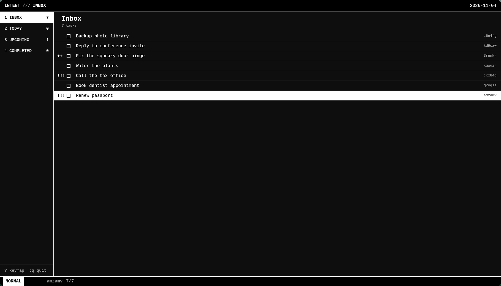
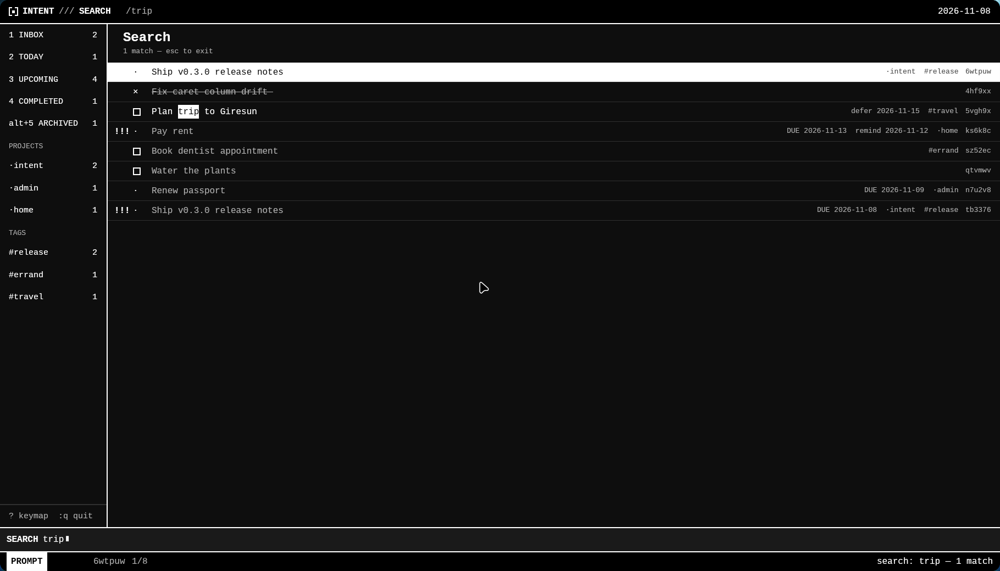

# INTENT

<p align="center"></p>

**A keyboard-first, local-first commitment tracker.** Vim reimagined as a
personal commitment-management system — not a todo app with shortcuts bolted on.



*Live search* — matches highlight as you type, `n`/`N` cycle:



- **Zero-friction capture** — `o`, type, `enter`. No project, priority, or date
  required. Organize later or never.
- **Real Vim grammar** — `d`, `c`, `y` with motions (`w`, `f`, `t`, `e`…),
  text objects (`diw`, `ca(`), counts (`3dd`), `.` repeat, visual modes,
  per-surface undo. Not isolated shortcuts.
- **External memory** — deadlines (`due`) and soft resurfacing (`remind`) are
  distinct; deferred tasks hide until you asked to see them again.
- **One database, two equal frontends** — a GPUI desktop app and a CLI built
  for humans *and* agents. No duplicated business logic.
- **Local-first** — one SQLite file. No accounts, no network, no AI.

---

## Install

Requires a Rust toolchain; the GUI additionally needs `clang`, `cmake`, and
`pkgconf` (GPUI's build deps) plus Wayland/X11 and Vulkan runtime libraries —
on Arch all of this is `rust clang cmake pkgconf`.

```sh
make build          # cargo build --release --locked
make test           # full workspace test suite
make install        # user-local: ~/.local/{bin,share/...} — no root needed
```

`make install` never compiles; it installs the release binaries, man pages,
shell completions (bash, zsh, fish), a desktop entry, and the icon. Remove
everything with `make uninstall`.

**System-wide, if you really want it:** `sudo make install PREFIX=/usr/local`.
On a personal machine this buys nothing over `~/.local` and needs sudo on
every update.

**Switching to a package later:** run `make uninstall` first — both
`~/.local/bin` and `/usr/local/bin` shadow `/usr/bin` in PATH, and
`intent --version` will tell you which binary is winning if in doubt.
The AUR package definition lives in `packaging/PKGBUILD`.

## Quick start

```sh
intent --help
```

**CLI:**

```sh
export PATH="$PWD/target/release:$PATH"

intent add "Renew passport"           # lands in the inbox, 6-char id printed
intent --help                         # full command surface
intent list inbox
intent edit <id> --due friday --project admin
intent list today
intent done <id>
intent search passport --json         # machine-readable output for agents
intent projects --json                # distinct projects + counts
intent tags --json                    # distinct tags + counts
```

**GUI:**

```sh
intent-gui                            # same database the CLI uses
```

The database lives at `$XDG_DATA_HOME/intent/tasks.db`
(`~/.local/share/intent/tasks.db`); override with `INTENT_DB=/path/tasks.db`.

Both processes may run simultaneously — writes are transactional and the GUI
reloads within 2 seconds when the CLI (or an agent) changes something.

---

## The keyboard (GUI)

`?` in the app shows the keymap. The essentials:

| Keys | Action |
|---|---|
| `j` `k` `gg` `G` `ctrl-d/ctrl-u` | move |
| `1`–`4` (`alt+1`–`5`) / `tab` | switch view / cycle views (`alt+5` = archived) |
| `o`, `space space`, `space c` | capture (inbox) |
| `enter` / `i` / `a` | edit task (title + notes, full Vim editing; `ctrl+j`/`ctrl+k` switch fields) |
| `x` | complete ⇄ reopen ⇄ revive |
| `space d` / `space u` / `space r` | defer / due / remind prompts (smart dates) |
| `space o` | organize: assign project, leave inbox |
| `>` `<` | shift due ±1 day (no due → today) |
| `+` `-` | raise / lower priority |
| `V` then `j` `x`/`d`/`y` | select tasks, complete/archive/yank them |
| `/` | live search — matches highlight as you type; `n`/`N` cycle |
| `d` / `space D` | archive / unarchive |
| `D D` | delete — first `D` arms the row (red), second confirms; undoable in-session |
| `y` `Y` | yank title / title+notes to the system clipboard |
| `u` / `ctrl-r` | undo / redo task operations |
| `.` | repeat last operation |
| `:` | command prompt (`:today`, `:due friday`, `:q`, …) |
| `?` | full keymap overlay |

Modes, pending sequences (no timeouts — they wait, visible in the status
line), and clipboard semantics (deletes never clobber your yank) follow
**[SPEC.md](SPEC.md)** — the authoritative interaction contract.

### Smart dates

Everywhere a date is accepted: `2026-11-02`, `today`, `tomorrow`,
`yesterday`, `+3d` `+2w` `+1m` `+1y`, `-2d`, weekdays (`mon`…`sun` — next
occurrence), and `none`/`-` to clear.

---

## For agents (and terminal humans)

The CLI is a first-class interface with stable output:

```console
$ intent add "Ship the thing" --json
{"id":"k3x9qa","title":"Ship the thing","notes":"","status":"active","inbox":true,...}

$ intent edit k3x9qa --due tomorrow --priority high --json
{ ...updated task... }

$ intent show k3x9qa --json | jq -r .due
2026-10-27
```

- `--json` on every command → one JSON value on stdout, errors as
  `{"error":{"code":"not_found","message":…}}` on stderr.
- Exit codes: `0` ok · `1` runtime · `2` usage · `3` not found · `4` bad value.
- Error codes are stable: `not_found`, `bad_date`, `bad_value`, `usage`,
  `io`, `db`.
- Mutations echo the resulting task; `delete` refuses non-interactively
  without `--force`.
- The task JSON field set is a stable contract (see SPEC §3).

Run `intent --help` for the full surface. `intent counts --json` gives
per-view totals cheaply, and `intent completions bash|zsh|fish` prints a
completion script (installed automatically by `make install`).

---

## Design guarantees (SPEC.md has the details)

- **Undo** — the GUI keeps a session undo stack for *task operations*
  (captures, completions, deletes — including resurrecting deleted tasks with
  their original ids) and a separate text-undo stack inside the editor. `u`
  in the list never crosses into text editing and vice versa.
- **Concurrency** — every mutation is a single SQLite transaction (WAL);
  concurrent CLI + GUI use is supported. Last writer wins per mutation; the
  GUI detects foreign writes via `PRAGMA data_version` and reloads.
- **Capture** — a task leaves the inbox only when it gains a project, a due,
  a remind, or an explicit organize. Priority/tags/notes never do.
- **No named registers, ever.** One edit buffer + the OS clipboard, with
  defined rules for what touches what.

---

## Architecture

```
crates/core   intent-core   model · SQLite store · lifecycle ops · views · search
crates/vim    intent-vim    pure modal editing engine (motions, operators,
                            text objects, counts, visual, undo, repeat)
crates/cli    intent        clap CLI over intent-core
crates/gui    intent-gui    pure interaction-model layer (tested headless)
                            + GPUI rendering shell (no logic)
```

`core`, `vim`, and the GUI's model layer import no windowing code, so the
entire interaction spec is covered by headless unit tests: view
classification, date parsing, undo snapshots, the complete Vim grammar,
prompt/focus guarantees, and the CLI contract end-to-end via the real
binary. Run `make test` for the current count.

## Repository layout

- [SPEC.md](SPEC.md) — the interaction specification (authoritative)
- [crates/core](crates/core) — business logic
- [crates/vim](crates/vim) — modal engine
- [crates/cli](crates/cli) — CLI
- [crates/gui](crates/gui) — GPUI app
- [docs/](docs) — man pages (`intent(1)`, `intent-gui(1)`)
- [packaging/](packaging) — desktop entry, logo, and the AUR `PKGBUILD`
- `scripts/spec_verify.py` — 37-check runtime conformance suite against SPEC
- `vendor/xattr` — patched copy of `xattr 0.2.3` (build fix for `libc ≥
  0.2.191`, wired via `[patch.crates-io]`)

## Testing

```sh
make test             # full workspace test suite
make check            # tests + fmt --check + clippy -D warnings + conformance
```

## Non-goals

Cloud sync, accounts, AI features, recurring tasks, notifications daemons,
collaboration, named registers, macros, regex search. See SPEC §7 — if a
feature cannot be added without breaking the spec's guarantees, the spec
changes first.
